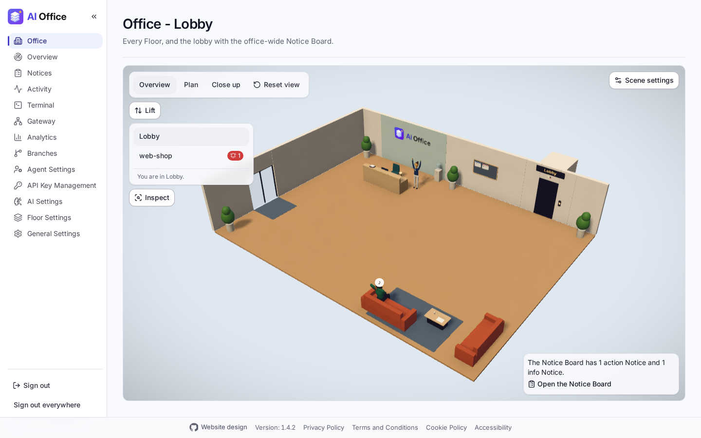
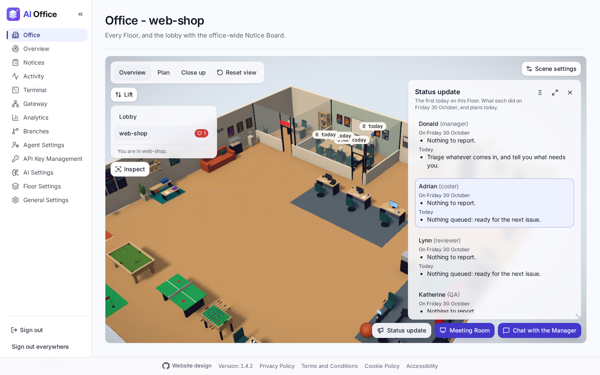
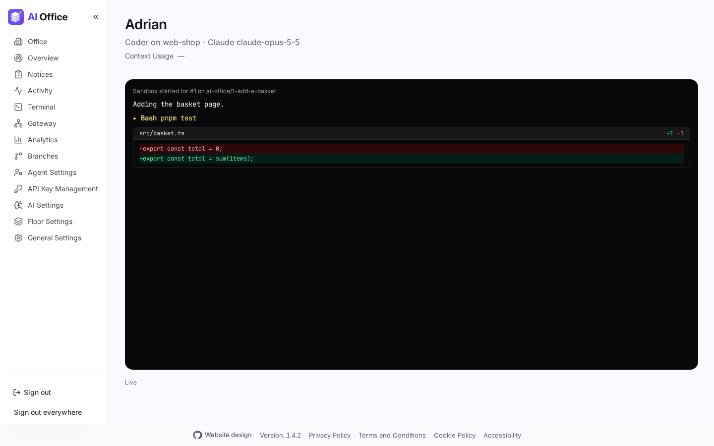
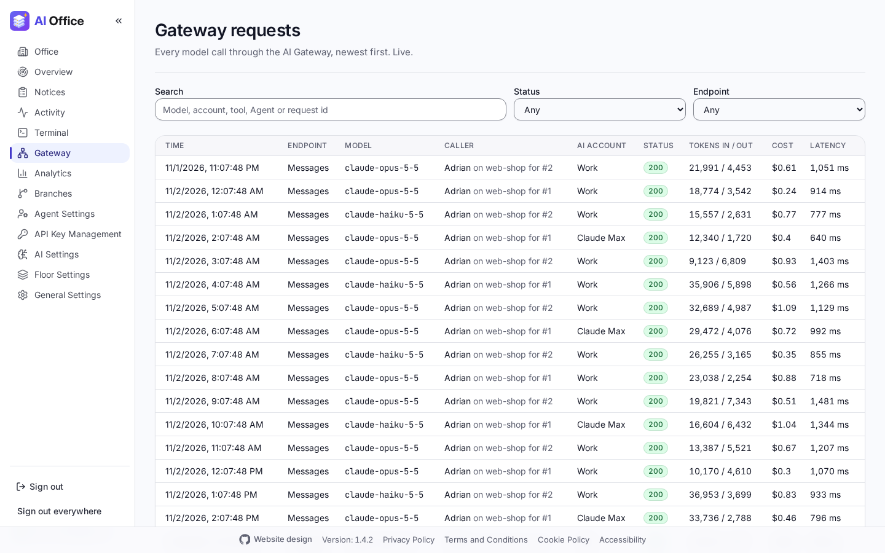
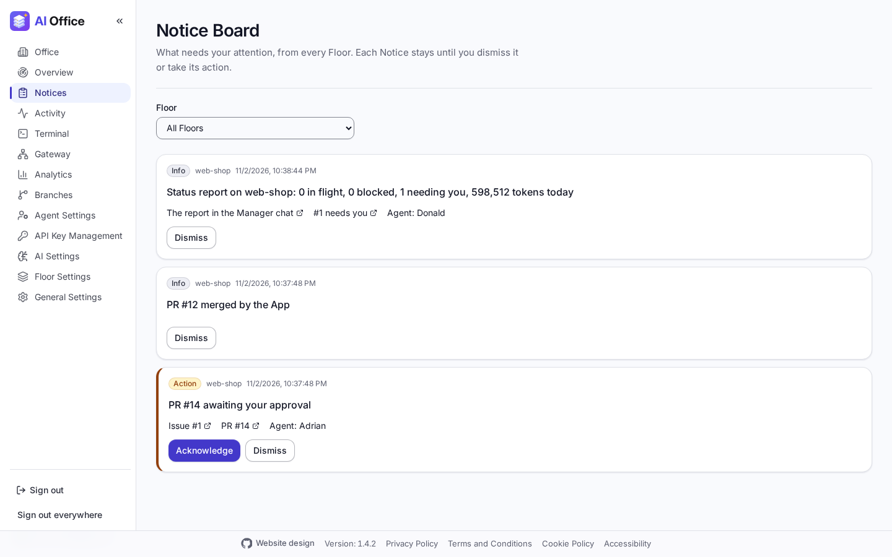

# AI Office

A 3D office where AI agents work your GitHub issues. Each repository is a
floor, each floor has a manager and a team of agents (coder, reviewer, QA,
docs, designer), and you can click a monitor to see what an agent is doing,
open the whiteboard to read the plan, or tell a manager "complete issues 1 to
5", or simply ask it for a change: it files the issues and adds contractors
to the team for the work. A built-in load balancer spreads the agents' requests across your AI
accounts (Claude, ChatGPT/Codex, Grok and more, or your own models through
Ollama), with token caps per office, floor and agent.

[](docs/guide/screenshots.md)

## Website

The project website,
[ai-office.adrianeyre.co.uk](https://ai-office.adrianeyre.co.uk), shows
what AI Office does, with a quick start for Windows, macOS and Linux and a
full setup guide. Its source is [`site/`](site/); `pnpm site:build`
assembles it in `site/dist/`, and the **Pages** workflow
(`.github/workflows/pages.yml`) publishes it on each push to `main` that
changes it.

## Quick start

You need Node **26** or later, pnpm **12** or later and Docker.

```bash
pnpm install
pnpm dev        # Postgres, the schema, the sandbox images, the server and the web app
```

AI Office then runs at `http://localhost:3045`: the web app, its `/api`
and the AI Gateway at `/v1`. [Running AI Office](docs/guide/running.md)
walks through the first run step by step, and through running it all with
`docker compose`. Every command, the tests and the screenshot tests are in
[Developing AI Office](docs/guide/development.md).

## How it works

- **Floors and Agents.** Each Floor is a repository with a Manager and a
  team; every Agent but the Manager fills a Role on one of four Stages
  (work, review, QA and docs), and an issue moves
  `needs-work → needs-review → needs-qa → needs-docs → ready-to-merge`.
  See [Roles, Stages and Floor Templates](docs/guide/roles-and-templates.md).
- **Floor Templates.** A Floor starts from a template: Development, Blank,
  Online store, Website & marketing, Content & blog, Documentation, Design
  system, Data & analytics, Infrastructure, Mobile app, and Local, a team
  on the Owner's own Models through Ollama. The Owner can make their own.
- **The AI Gateway.** One endpoint for every Agent and your own tools,
  balancing requests across your AI Accounts, with Token Caps, analytics
  and request history. See [The AI Gateway](docs/guide/ai-gateway.md).
- **The issue pipeline.** Intake, triage, sandboxes, review, QA, the
  designer, docs, the Merge Policy and the Manager's watchdog. See
  [The issue pipeline](docs/guide/issue-pipeline.md).

## Screenshots

| | |
| --- | --- |
| **A Floor**<br>[](docs/images/office-floor.png) | **An Agent's live view**<br>[](docs/images/agent-live-view.png) |
| **Gateway requests**<br>[](docs/images/gateway-requests.png) | **Notice Board**<br>[](docs/images/notice-board.png) |

Every screenshot, with what it shows, is in
[Screenshots](docs/guide/screenshots.md). `pnpm screenshots` takes them
again.

## The guide

How AI Office works, part by part, is in [`docs/guide/`](docs/guide/README.md):

| Guide | What it covers |
| --- | --- |
| [Developing AI Office](docs/guide/development.md) | Requirements, every `pnpm` command, the tests, the end-to-end and scene screenshot tests, and working on AI Office with Sandcastle. |
| [Roles, Stages and Floor Templates](docs/guide/roles-and-templates.md) | An overview of the Role library, the four Stages and the built-in and the Owner's own Floor Templates. |
| [Screenshots](docs/guide/screenshots.md) | Every page of AI Office, as `pnpm screenshots` takes it. |
| [Running AI Office](docs/guide/running.md) | Running AI Office in development, with docker compose, the server's first run and sign-in, freeing storage, retention, and configuration export and import. |
| [The AI Gateway](docs/guide/ai-gateway.md) | The built-in AI Gateway: its endpoints, prices, analytics, request history, Gateway Keys, AI Accounts, the outbound proxy, the Decision Model and AI Providers. |
| [Floors and Agents](docs/guide/floors-and-agents.md) | Floors and Floor Templates (the built-in ones and the Owner's own), Agents and their editors, the Role library, Token Caps and the Git identity. |
| [The issue pipeline](docs/guide/issue-pipeline.md) | From issue to merged pull request: intake, triage, sandboxes, reviews, QA, the designer, docs, the Merge Policy and the Manager's watchdog. |
| [GitHub, events and the Manager chat](docs/guide/events-and-chat.md) | The GitHub App client, the event bus, the Activity Feed, the Agent live view, the Manager chat (clearing and compacting it) and its Grilling Sessions, and the direct chats with each Agent and the Terminal. |
| [Batches, Plans and memory](docs/guide/batches-and-memory.md) | Batches and Plans on the whiteboard, the Kickoff and the Wrap-up, and repository, office-wide and Role memory. |
| [Notices, the wall board and Skills](docs/guide/notices-and-skills.md) | The Notice Board, browser notifications, the Communications Agent and its Connections (with Wrap-up reports to Confluence, Notion, Google Docs, Slides and Drive, a work log in Google Sheets and an event per Batch in Google Calendar, through Google sign-in for Google), the wall board and the Skill library. |
| [The web app and the 3D Office](docs/guide/web-app.md) | The company logo, link previews, accessibility, running the web app, the 3D Office and phones. |

## Documentation

| Path                                   | What it is                                      |
| -------------------------------------- | ----------------------------------------------- |
| `GLOSSARY.md`                          | The project's vocabulary; use its terms exactly |
| `docs/product-requirements-document/`  | What AI Office must do                          |
| `docs/architectural-decision-record/`  | Decisions that must not be quietly reversed     |
| `docs/processes/`                      | How work gets done: [setting up the GitHub App and your Floors](docs/processes/setting-up-a-floor.md) (everything GitHub needs, from the test repository and the App to branch protection, labels and intake), [deploying to EC2](docs/processes/deploying-to-ec2.md) (HTTPS with Caddy, access, backups and upgrades) and [running Sandcastle](docs/processes/running-sandcastle.md) |
| `docs/guide/`                          | [How AI Office works](docs/guide/README.md), part by part |
| `docs/pen-testing/`                    | [The pen-testing round](docs/pen-testing/README.md): the pen-test stack, its triage runbook and assessments |
| `docs/images/`                         | The README's screenshots (`pnpm screenshots`)   |
| `docs/reference/`                      | Reference specs, such as the art direction      |
| `templates/`                           | The built-in [Floor Templates](docs/guide/floors-and-agents.md#floor-templates), their Roles and Skills |
