# AI Office

A 3D office where AI agents work your GitHub issues. Each repository is a
floor, each floor has a manager and a team of agents (coder, reviewer, QA,
docs, designer), and you can click a monitor to see what an agent is doing,
open the whiteboard to read the plan, or tell a manager "complete issues 1 to
5", or simply ask it for a change: it files the issues and adds contractors
to the team for the work. A built-in load balancer spreads the agents' requests across your AI
accounts (Claude, ChatGPT/Codex, Grok and more), with token caps per office,
floor and agent.

> **Status:** planning. Nothing is built yet. The requirements live in
> [`docs/product-requirements-document/`](docs/product-requirements-document/)
> and the decisions in
> [`docs/architectural-decision-record/`](docs/architectural-decision-record/).
> This repository will become
> [github.com/adrianeyre/ai-office](https://github.com/adrianeyre/ai-office).

## Website

The project website,
[ai-office.adrianeyre.co.uk](https://ai-office.adrianeyre.co.uk), shows
what AI Office does, with screenshots, a quick start for Windows, macOS
and Linux, and a full setup guide. Its source is [`site/`](site/):
`pnpm site:build` assembles it in `site/dist/`, copying in the
screenshots from `docs/images/` and the logo and icons from `apps/web`,
and the **Pages** workflow (`.github/workflows/pages.yml`) builds and
publishes it on each push to `main` that changes it. The repository's
address on it is set once, in `site/build.ts`.

## Requirements

- Node **26** or later and pnpm **12** or later (`devEngines` in
  `package.json`; older versions are refused)
- Docker, for the Sandcastle sandboxes and the Postgres integration tests

## Getting started

```bash
pnpm install
```

| Command          | What it does                                             |
| ---------------- | -------------------------------------------------------- |
| `pnpm dev`       | Runs the whole of AI Office for development in Docker (`docker-compose.dev.yml`): Postgres, the server (restarts on change, schema applied as it starts), Vite (hot reload), the sandbox relay and an HTTPS proxy, at https://ai-office.localhost, after building any sandbox image not built yet; Ctrl+C stops it. See [Running in development](docs/guide/running.md#running-in-development) |
| `pnpm dev:down` | Stops a development stack left running (`docker compose -f docker-compose.dev.yml stop`) |
| `pnpm lint`      | ESLint (type-aware) and a Prettier check                 |
| `pnpm typecheck` | `tsc` for the root config and every workspace package    |
| `pnpm test`      | Vitest, with each workspace package as its own project   |
| `pnpm format`    | Prettier and `eslint --fix`, rewriting files in place    |
| `pnpm build`     | Builds every package that has a build (the web app)      |
| `pnpm db:schema` | Apply the schema to the database at `DATABASE_URL` if it is empty, or check it is the same schema if not |
| `pnpm db:reset` | Recreate the development Postgres, empty, and apply the schema |
| `pnpm db:up` / `pnpm db:down` | Start / stop the development Postgres on its own (`docker-compose.dev.yml`), for the tests or `pnpm db:schema` |
| `pnpm e2e`       | Builds the web app, then runs the Playwright end-to-end tests |
| `pnpm scenes`    | Screenshot tests of the 3D scenes in headless Chromium with software WebGL, without a GPU: the 3D Office's key scenes (see [Scene screenshot tests](#scene-screenshot-tests)) and a Floor in each 3D theme (see [the guide](docs/guide/web-app.md#screenshot-tests-of-the-3d-scenes)) |
| `pnpm screenshots` | Builds the web app, then retakes the README's screenshots in `docs/images/` |
| `pnpm sandbox:build` | Builds the sandbox images for Claude Code, Codex and opencode (needs Docker); for compose, `AGENT_UID=1000 AGENT_GID=1000 pnpm sandbox:build` |
| `pnpm sandbox:ensure` | Builds only the sandbox images not built yet; `pnpm dev` runs it first |
| `docker compose up --build` | Runs the whole AI Office in Docker: the app, Postgres, and Agents' and the Manager chat's sandboxes, started from inside the app (build the sandbox images first, as above); see [Running with docker compose](docs/guide/running.md#running-ai-office-with-docker-compose) |

AI Office has one address: `https://ai-office.localhost` in `pnpm dev`
(trust its local CA once, as [Running in development](docs/guide/running.md#running-in-development)
says) and `http://localhost:3045` under compose. It serves the web app, its `/api`, and the AI Gateway at `/v1`.
Point your own tools at it with a Gateway Key from **API Key Management**:
Claude Code with `ANTHROPIC_BASE_URL=http://localhost:3045`, Codex and
other OpenAI clients with `http://localhost:3045/v1` (see
[Gateway Keys](docs/guide/ai-gateway.md#gateway-keys)). Whatever that
address is opened to, the Gateway is too, still behind Gateway Keys; to
open it beyond your machine, use compose's `tls` profile.

Tests that need Postgres start Postgres 18 with Testcontainers, so they need
Docker. Without it they are skipped with the reason (or fail when `CI` is
set, so CI never skips them). AI Office is not in production yet, so its
schema has no migrations: it is one plain SQL file, `packages/db/schema.sql`.
After changing `packages/db/src/schema.ts` (or
`src/schema-extras.sql`, the trigger and starting rows it cannot say),
`pnpm --filter @ai-office/db db:generate` writes it again, and
`pnpm db:reset` recreates the development database from it.

### End-to-end tests

`pnpm e2e` builds the web app and runs the Playwright suites in `e2e/` in
Chromium. Postgres 18 is started once with Testcontainers and the schema is
applied to a template database. Each test then gets a fresh copy, and its own server
process on a free port, so tests start from a first run and can run in
parallel. Each server's GitHub App talks to the test's own fake GitHub
(`office.github`), served over HTTP through `GITHUB_API_URL`.

The server process is `e2e/server/main.ts`: AI Office started as
`apps/server/src/main.ts` starts it, plus an IPC channel to the test. Through
it a test does what no part of AI Office does yet: `office.raiseNotice()`
raises a Notice, and `office.publish()` publishes an event on the bus.
`office.pollIntake()` runs issue intake at once. With no Docker, Agents'
tasks go to a stand-in sandbox runner (`startOffice`'s `sandboxRunner`
option), which records each task's Agent, AI Provider, Model and effort
(`office.sandboxTasks()`) and fails it.

```bash
pnpm --filter @ai-office/e2e exec playwright install chromium   # once
pnpm e2e
```

Without Docker the tests are skipped with the reason (CI fails instead).
To use a Postgres you already run, set `E2E_POSTGRES_URL` to a superuser
URL for it. Failed tests keep a trace, a screenshot and the server's log in
`e2e/test-results/` (`pnpm --filter @ai-office/e2e exec playwright
show-trace <trace.zip>`); CI uploads them as the `playwright-traces`
artifact.

### Scene screenshot tests

`pnpm scenes` compares the 3D Office's key scenes with reference
pictures (PRD §9, Visual): the lobby, its reception desk close in, a
Floor, the same Floor with the Context Usage bars and tokens above its
Agents' heads, its meeting room and the Avatar Editor's preview. It needs
no GPU, no Docker and no server.

- **The scenes** are drawn by the Office's own components
  (`OfficeScene`, `AvatarPreview`) on a page of their own,
  `apps/web/screenshots/`, never part of the app's build. Its data is
  fixed (`screenshots/scene-data.ts`). It has a Floor of seven Agents
  whose Avatars come from fixed seeds (`seededRandom`), and they show
  every state the Office draws at a desk: working at a lit monitor,
  waiting on review, paused, capped, and piles of tickets. It also has
  fixed Notices on the boards and lift stops, and in the lobby the
  Communications Agent at reception (its Avatar from a fixed seed) and
  the visitor, three envelopes in the out-tray and a failing Connection's
  red marker (FR-96). Above the Floor's Agents' heads (FR-62, FR-85), the
  busy coder has its Context Usage bar and its tokens today, the idle
  designer its tokens alone, and others tokens at 80% and at 100% of the
  daily cap, built from fixed Context Usage and token usage as the API
  sends them. Each scene has a fixed camera: the Office's
  overview for the lobby and both Floor scenes, the view the Office flies to when
  the Communications Agent is clicked for the reception desk (without the
  marker it differs by 741 pixels; the overview alone would not notice),
  a view into the meeting room, and the preview's own. They are drawn at Medium
  quality with reduced motion, so nothing moves. The models and the logo
  load before the first frame. After ten frames the page stops drawing
  and says it is ready (`data-scene="ready"` on `<html>`).
- **The browser** is Playwright's headless Chromium with WebGL in
  software (SwiftShader through ANGLE, `--use-angle=swiftshader`), at
  1280 × 720 and a device pixel ratio of 1. Each test checks it really
  draws with SwiftShader. Only the canvas is compared, so fonts play no
  part, except in the scene with the displays above the Agents' heads:
  they are HTML over the canvas, so that one compares the canvas and its
  labels together, after checking the labels' text and colours in the
  page. The page sets its fonts to DejaVu (`screenshots/styles.css`),
  which Debian and Ubuntu both ship, so the labels' text is drawn alike
  on every Linux. Without the coder's bar it differs by 1,653 pixels.
- **The tolerance** (`e2e/scenes/scenes.spec.ts`): a pixel counts as
  changed past Playwright's default colour threshold (0.2), and a picture
  fails when more than 100 pixels change. Repeated runs of the same build
  differ by none. One Agent stopping work on the Floor changes 252 pixels,
  and another hair colour in the preview changes 418.
- **The reference pictures** are in `e2e/scenes/reference/`, named
  for Linux, where CI runs them. After a change to how a scene looks, look
  at the new pictures, then take them again and commit them:

```bash
pnpm --filter @ai-office/e2e exec playwright install chromium   # once
pnpm scenes                       # compare
pnpm scenes --update-snapshots    # take new reference pictures
```

`e2e/playwright.scenes.config.ts` builds the page and serves it on
127.0.0.1:3049 (`pnpm --filter @ai-office/web screenshots:serve`), as its
`key-scenes` project. The same command also runs the Floor themes'
screenshot tests, its `chromium` project, on a page of their own (see
[the guide](docs/guide/web-app.md#screenshot-tests-of-the-3d-scenes));
`--project=key-scenes` runs these alone. A failed
comparison leaves the actual, expected and diff pictures in
`e2e/test-results/scenes/`. CI's **Screenshots** job uploads them as
the `screenshot-differences` artifact.

The workspace follows the layout in §8 of the PRD: `apps/server`,
`apps/web`, and
`packages/{orchestrator,gateway,github,communications,db,events,shared}`.

## Roles and Stages

Every Agent but the Manager fills a Role from the office Role library
(the `roles` table): a name, instructions, Skills, desk dressing, a
suggested AI Provider and Model, and one of four fixed Stages: work,
review, QA and docs
([ADR 0003](docs/architectural-decision-record/0003-roles-are-data-on-four-fixed-stages.md)).
The library starts with coder, reviewer, QA, docs and designer. Each
Stage has its label, and an issue moves through them:

```text
needs-work → needs-review → needs-qa → needs-docs → ready-to-merge (or needs-human)
```

The pipeline, the Review Loop, Round Caps, the Merge Policy and dispatch
go by a Role's Stage, never its name, so a new work-Stage Role is
dispatched like a coder. When a Floor has several work Roles (a
merchandiser and a copywriter, say), the Manager's triage gives each
issue to one by the Roles' routing descriptions; a `role:<name>` label,
which AI Office creates for each work Role, forces one, and when the
Manager cannot tell it asks the Owner with a Notice offering each
candidate Role
([routing](docs/guide/issue-pipeline.md#routing-between-work-roles)).
A Batch's Plan may instead give an issue an ordered list of work Roles
(the merchandiser, then the copywriter), which take turns on its one
branch, each handing it to the next, before review; the Owner can
reorder or remove them on the whiteboard, and a Review Loop fix goes
back to the Role whose changes it concerns
([several work Roles on one issue](docs/guide/batches-and-memory.md#several-work-roles-on-one-issue)).
In **Admin → Role library** (`/general-settings/roles`) the
Owner makes, duplicates and edits Roles, and deletes one no Agent fills;
Floor Settings adds Agents in any of them. Changing a Role changes every
Agent with it from its next task (the editor says how many), and an
Agent's own extra instructions still apply on top. Every change is in
the Activity Feed. `needs-work`
was called `needs-code`: on a Floor added before, AI Office renames the
repository's label when it starts, and GitHub keeps it on its issues. See
[Floors and Agents](docs/guide/floors-and-agents.md#roles-and-the-role-library).

## Floor Templates

Adding a Floor means picking a Floor Template: its starting team,
settings and labels. **Admin → Add a Floor** shows each template's name,
description, icon and starting team, and starts on **Development**, the
team every Floor had before templates (a Manager, a coder, a reviewer and
QA). **Blank** is a Manager only. **Online store** (a merchandiser, a
copywriter, a storefront developer, a brand reviewer and store QA),
**Website & marketing** (a web developer, a copywriter, an SEO specialist
and a conversion reviewer) and **Content & blog** (a writer, an SEO
specialist, an editor and a fact-checker) set up Floors that are not for
software: each runs its checks as npm scripts that its suggested first
issue sets up, and works on its repository only, never on a live store,
an ad platform or customer email. **Documentation** (a technical writer,
a docs reviewer and an example checker), **Design system** (a designer, a
front-end developer, an accessibility reviewer and visual QA), **Data &
analytics** (an analytics engineer, a data reviewer and data-quality QA),
**Infrastructure** (a platform engineer, a security reviewer and plan
QA) and **Mobile app** (a mobile developer, a reviewer and device-test
QA) do the same for their own checks: the docs build, links and runnable
examples; component tests, visual snapshots and contrast; `dbt test` and
SQL lint on sample data; `terraform plan` from no state and policy
checks, and never an apply; unit and simulator tests. Each says plainly
what its Floor never acts on (the live docs site, a package registry,
the production warehouse, live infrastructure, the app stores). The
template's Roles and Skills join
the Role and Skill libraries where they are missing; the Floor remembers
which template it started from, and nothing depends on the template
afterwards. Each template has a 3D theme, which the Floor keeps: stock
shelves and parcels for Online store, a photo studio for Website &
marketing, bookshelves and a printing press for Content & blog, a wall of
bookcases for Documentation, colour swatches for Design system, wall
dashboards for Data & analytics, server racks for Infrastructure and a
wall of phones for Mobile app; Development and Blank keep the office as
it was. Each desk is dressed as its Role is in the Role library (a
copywriter's notebooks, a merchandiser's product samples). Themes and
dressing are decoration only. Built-in
templates are folders under [`templates/`](templates/) (`template.yaml`,
`roles/<role>.md` and `skills/<name>/`), loaded and checked as AI Office
starts.

In **Admin → Floor Templates** (`/general-settings/templates`) the Owner makes
templates of their own: they duplicate one (the built-in ones are
read-only) and edit its Roles and counts, settings, the Manager's
guidance, labels and theme; save a Floor's set-up as a new template from
its admin page; export a template, with its Roles and Skills, to a file;
and import one from such a file or a Git repository. An imported template
shows its full contents (every Role's instructions and every Skill) and
its clashes with the Role and Skill libraries, and no Floor can be added
from it until the Owner has read it and enabled it. The Owner's templates
are stored in AI Office, every add, change and removal is in the Activity
Feed, and they are part of configuration export and import. See
[Floors and Agents](docs/guide/floors-and-agents.md#floor-templates).

## Screenshots

Taken with `pnpm screenshots`, which runs the built app against Postgres with a
fake GitHub and writes them to [`docs/images/`](docs/images/).

| | |
| --- | --- |
| **The Office**<br>[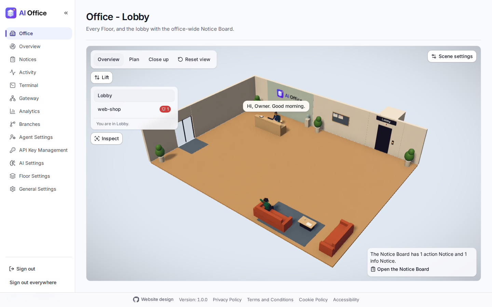](docs/images/office.png)<br>The 3D Office: the lobby, the lift to each Floor and the Notice Board. | **A Floor**<br>[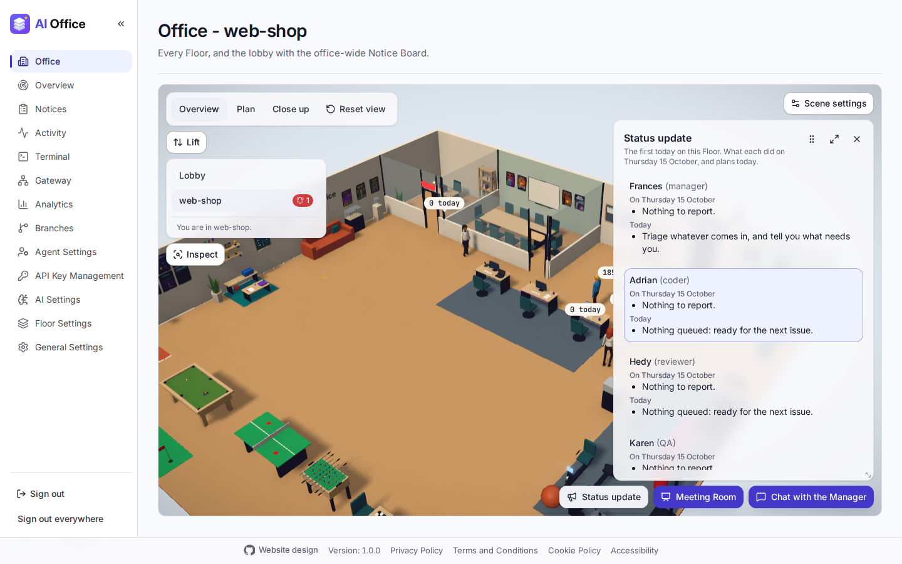](docs/images/office-floor.png)<br>A Floor's team at their desks, the Manager's office, the meeting room and the break area, with a button to chat with the Manager. |
| **Overview**<br>[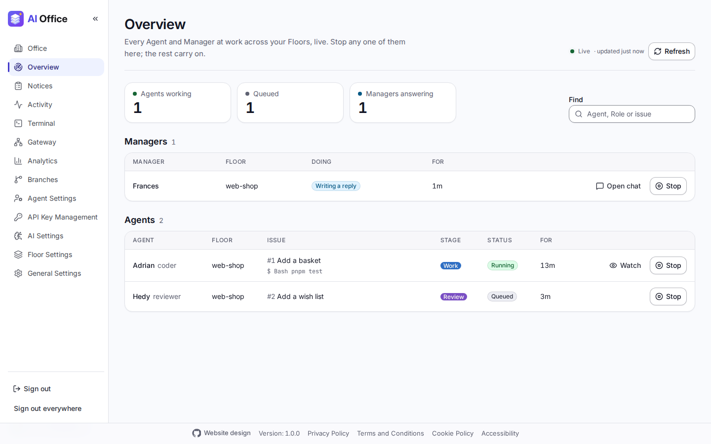](docs/images/overview.png)<br>Every Agent's work and every Manager's answer across the Floors, live, each with a Stop button. | **Notice Board**<br>[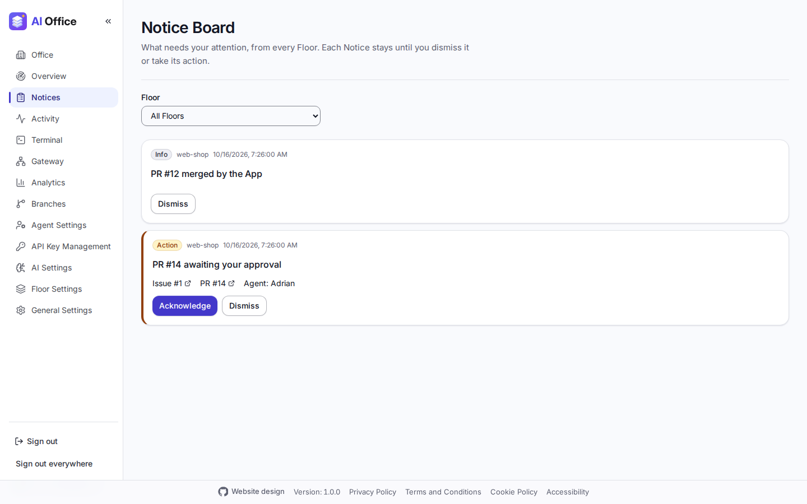](docs/images/notice-board.png)<br>Action and info Notices, office-wide and per Floor. |
| **An Agent's live view**<br>[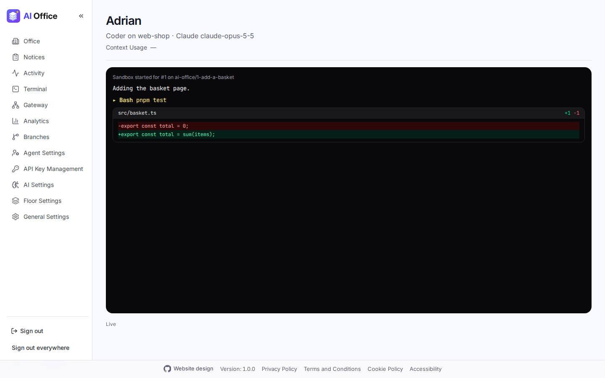](docs/images/agent-live-view.png)<br>An Agent's sandbox as it works: its text, tool calls and diffs. | **Activity**<br>[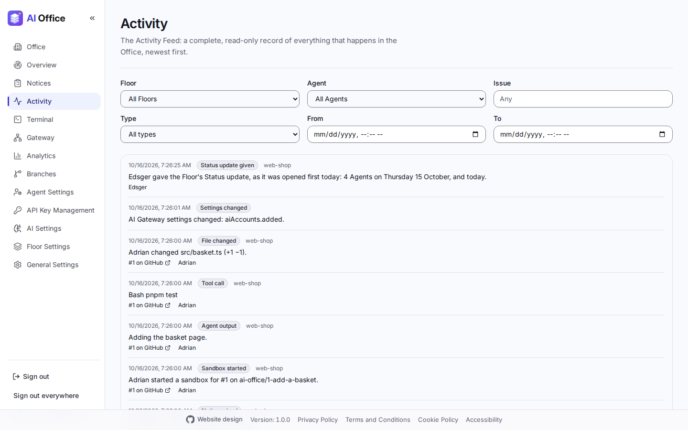](docs/images/activity.png)<br>Every event, filtered by Floor, Agent, issue, type and time. |
| **Gateway requests**<br>[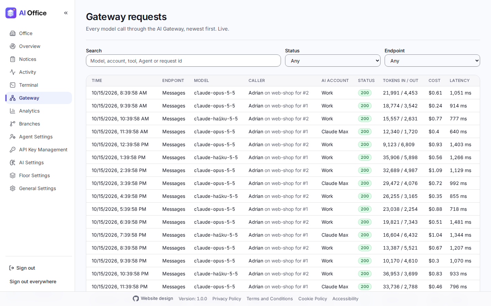](docs/images/gateway-requests.png)<br>Every request through the AI Gateway, with its tokens, cost and timings. | **Analytics**<br>[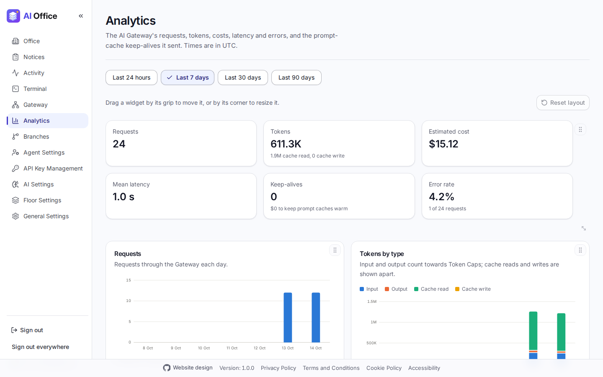](docs/images/analytics.png)<br>Requests, tokens, cost, latency and errors over time. |
| **AI Settings**<br>[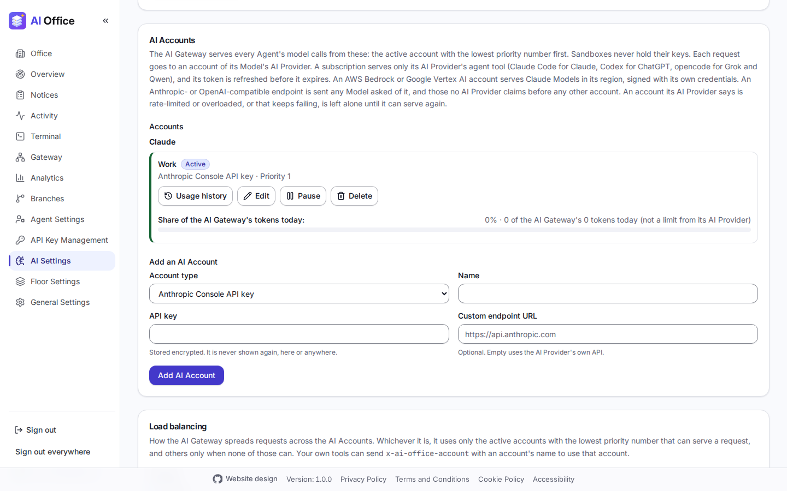](docs/images/ai-settings.png)<br>AI Providers, AI Accounts (a Claude subscription shows its 5-hour and weekly usage) and the Gateway's configuration. | **General Settings**<br>[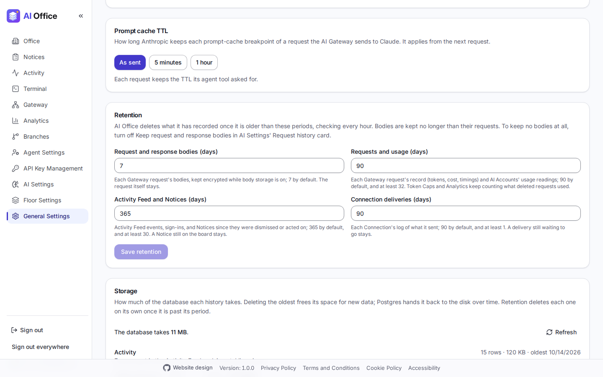](docs/images/admin-storage.png)<br>Office settings, the prompt-cache TTL and Storage, which frees space by deleting old history. |
| **Agent Settings**<br>[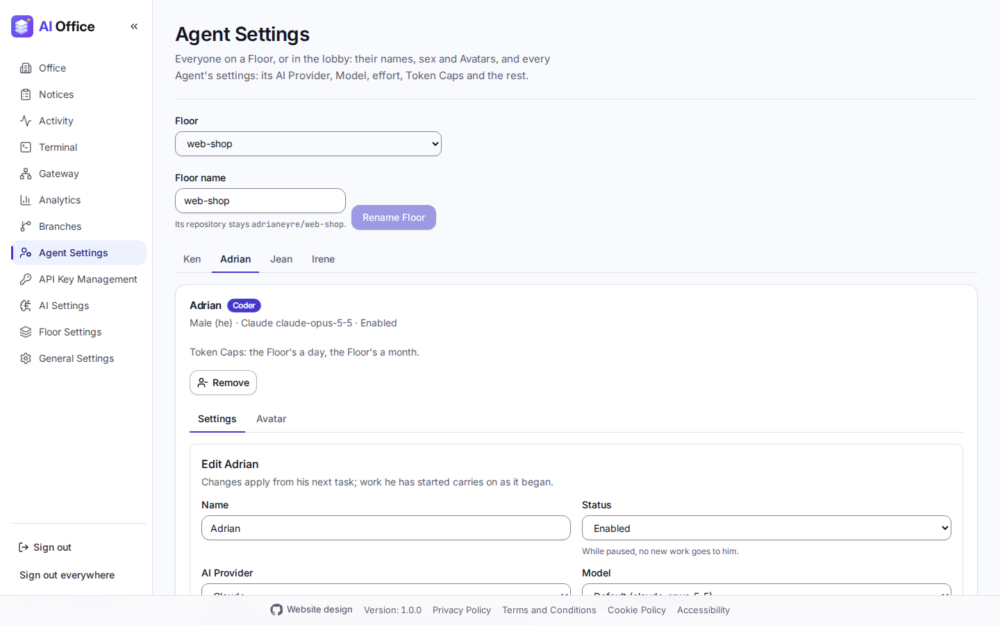](docs/images/agent-settings.png)<br>A tab for each Agent on a Floor, with its settings (AI Provider, Model, Token Caps and the rest) and its Avatar. | **Floor Settings**<br>[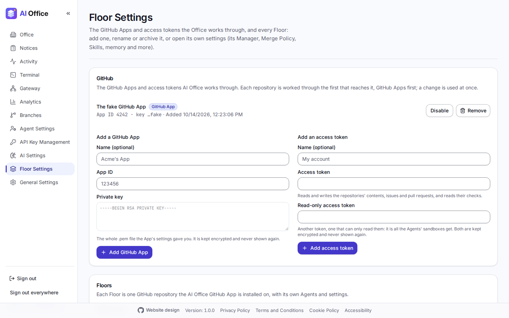](docs/images/floor-settings.png)<br>The GitHub Apps and access tokens AI Office works through, and every Floor. |

## The guide

How AI Office works, part by part, is in [`docs/guide/`](docs/guide/README.md):

| Guide | What it covers |
| --- | --- |
| [Running AI Office](docs/guide/running.md) | Running AI Office in development, with docker compose, the server's first run and sign-in, freeing storage, retention, and configuration export and import. |
| [The AI Gateway](docs/guide/ai-gateway.md) | The built-in AI Gateway: its endpoints, prices, analytics, request history, Gateway Keys, AI Accounts, the outbound proxy, the Decision Model and AI Providers. |
| [Floors and Agents](docs/guide/floors-and-agents.md) | Floors and Floor Templates (the built-in ones and the Owner's own), Agents and their editors, the Role library, Token Caps and the Git identity. |
| [The issue pipeline](docs/guide/issue-pipeline.md) | From issue to merged pull request: intake, triage, sandboxes, reviews, QA, the designer, docs, the Merge Policy and the Manager's watchdog. |
| [GitHub, events and the Manager chat](docs/guide/events-and-chat.md) | The GitHub App client, the event bus, the Activity Feed, the Agent live view, the Manager chat (clearing and compacting it) and its Grilling Sessions, and the direct chats with each Agent and the Terminal. |
| [Batches, Plans and memory](docs/guide/batches-and-memory.md) | Batches and Plans on the whiteboard, the Kickoff and the Wrap-up, and repository, office-wide and Role memory. |
| [Notices, the wall board and Skills](docs/guide/notices-and-skills.md) | The Notice Board, browser notifications, the Communications Agent and its Connections (with Wrap-up reports to Confluence, Notion, Google Docs, Slides and Drive, a work log in Google Sheets and an event per Batch in Google Calendar, through Google sign-in for Google), the wall board and the Skill library. |
| [The web app and the 3D Office](docs/guide/web-app.md) | The company logo, link previews, accessibility, running the web app, the 3D Office and phones. |

## Working on AI Office with Sandcastle

AI Office's own issues are worked by a coding agent inside a Docker sandbox
using [Sandcastle](https://github.com/mattpocock/sandcastle)
(`@ai-hero/sandcastle`). Setup, running, writing prompts and landing a run
are covered in
[`docs/processes/running-sandcastle.md`](docs/processes/running-sandcastle.md).

```bash
cp .sandcastle/.env.example .sandcastle/.env   # then fill in credentials
pnpm exec sandcastle docker build-image
git checkout -b issue-9-some-slice origin/main
pnpm sandcastle 9
```

## Documentation

| Path                                   | What it is                                      |
| -------------------------------------- | ----------------------------------------------- |
| `GLOSSARY.md`                          | The project's vocabulary; use its terms exactly |
| `docs/product-requirements-document/`  | What AI Office must do                          |
| `docs/architectural-decision-record/`  | Decisions that must not be quietly reversed     |
| `docs/processes/`                      | How work gets done: [setting up the GitHub App and your Floors](docs/processes/setting-up-a-floor.md) (everything GitHub needs, from the test repository and the App to branch protection, labels and intake), [deploying to EC2](docs/processes/deploying-to-ec2.md) (HTTPS with Caddy, access, backups and upgrades) and [running Sandcastle](docs/processes/running-sandcastle.md) |
| `docs/guide/`                          | [How AI Office works](docs/guide/README.md), part by part |
| `docs/pen-testing/`                    | [The pen-testing round](docs/pen-testing/README.md): the pen-test stack, its triage runbook and assessments |
| `docs/images/`                         | The README's screenshots (`pnpm screenshots`)   |
| `docs/reference/`                      | Reference specs, such as the art direction      |
| `templates/`                           | The built-in [Floor Templates](docs/guide/floors-and-agents.md#floor-templates), their Roles and Skills |
