# Screenshots

Taken with `pnpm screenshots`, which runs the built app against Postgres with a
fake GitHub and writes them to [`docs/images/`](../images/).

| | |
| --- | --- |
| **The Office** [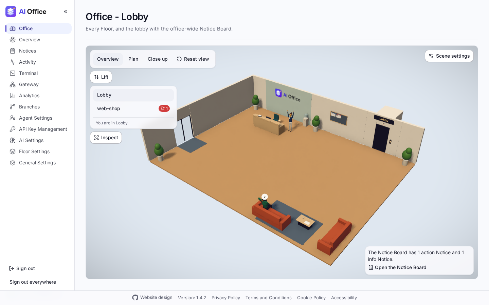](../images/office.png) The 3D Office: the lobby, the lift to each Floor and the Notice Board. | **A Floor** [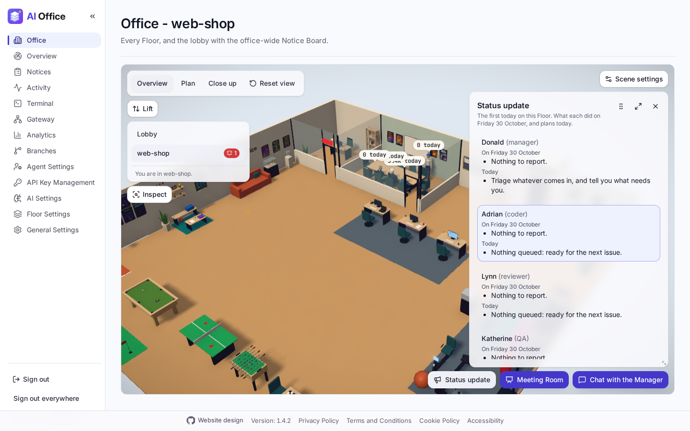](../images/office-floor.png) A Floor's team at their desks, the Manager's office, the meeting room and the break area, with a button to chat with the Manager. |
| **Overview** [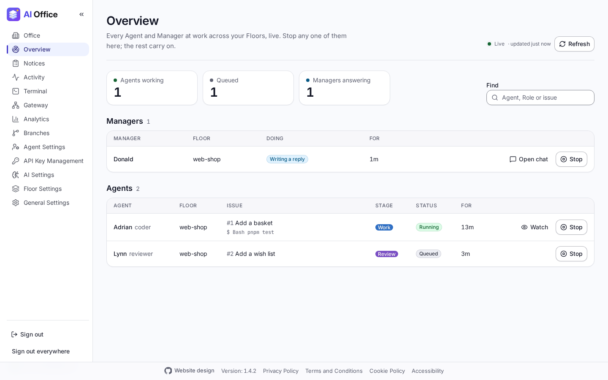](../images/overview.png) Every Agent's work and every Manager's answer across the Floors, live, each with a Stop button. | **Notice Board** [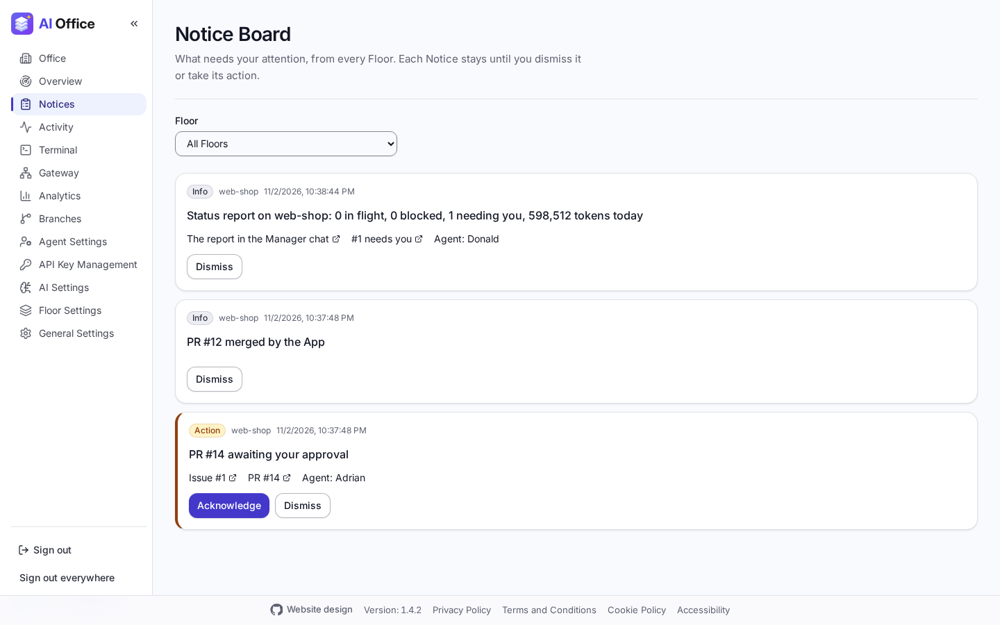](../images/notice-board.png) Action and info Notices, office-wide and per Floor. |
| **An Agent's live view** [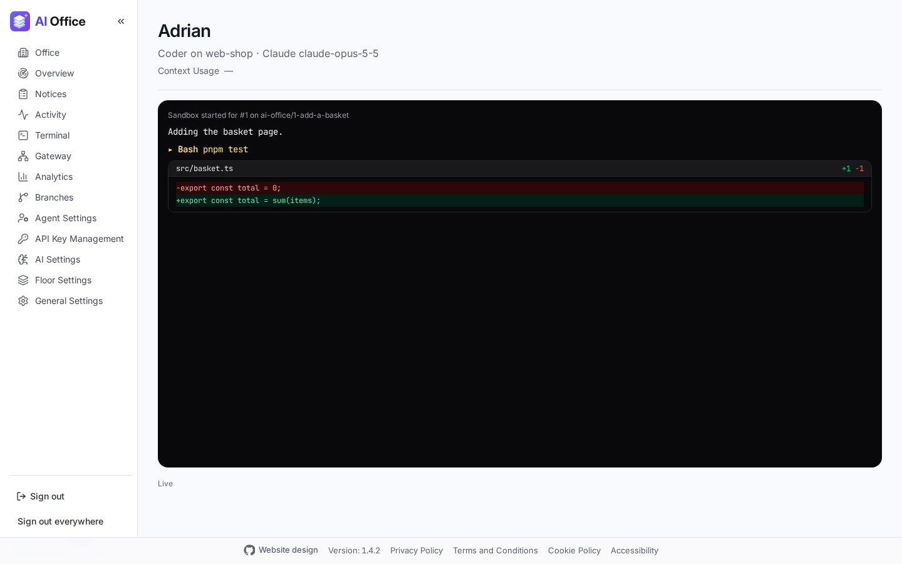](../images/agent-live-view.png) An Agent's sandbox as it works: its text, tool calls and diffs. | **Activity** [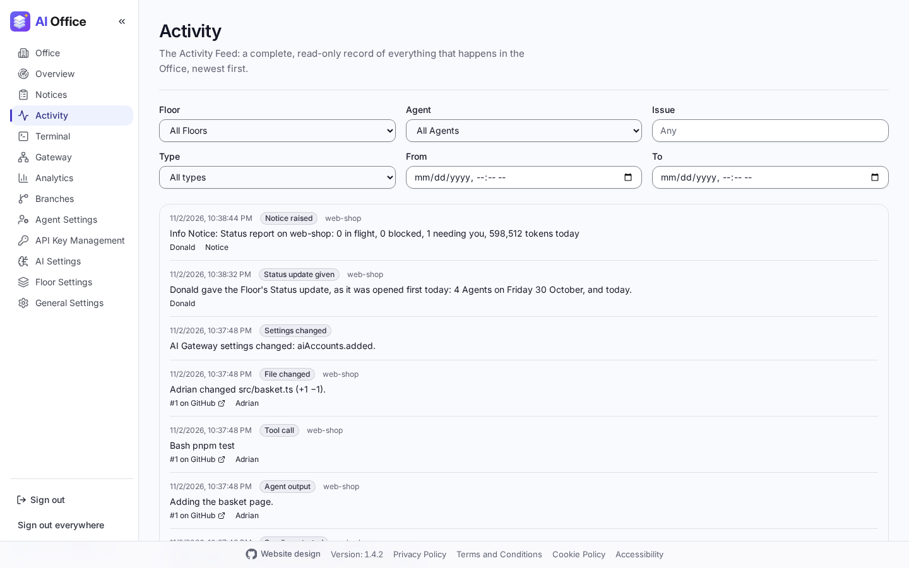](../images/activity.png) Every event, filtered by Floor, Agent, issue, type and time. |
| **Gateway requests** [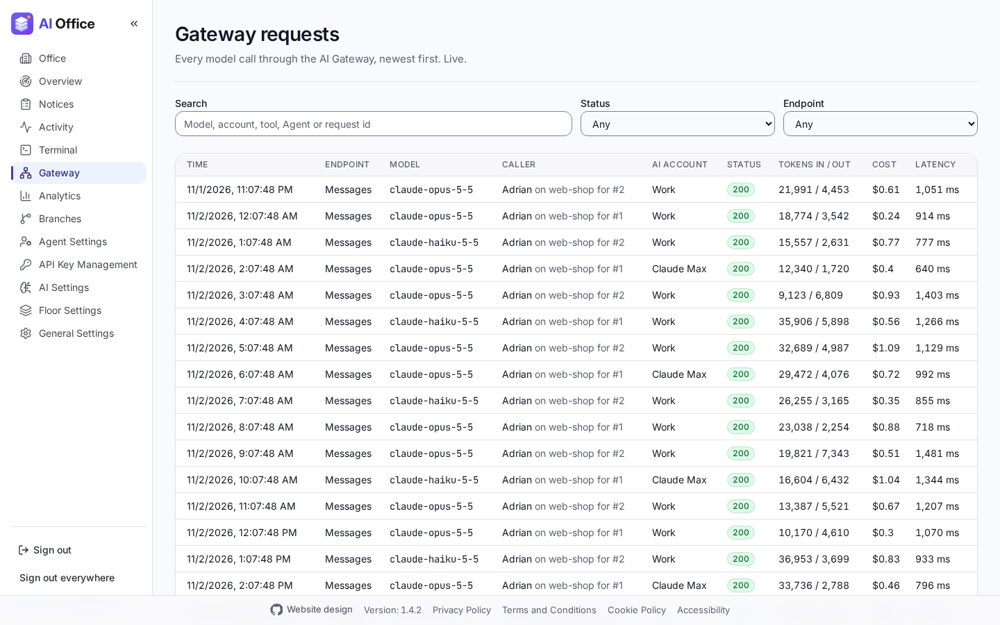](../images/gateway-requests.png) Every request through the AI Gateway, with its tokens, cost and timings. | **Analytics** [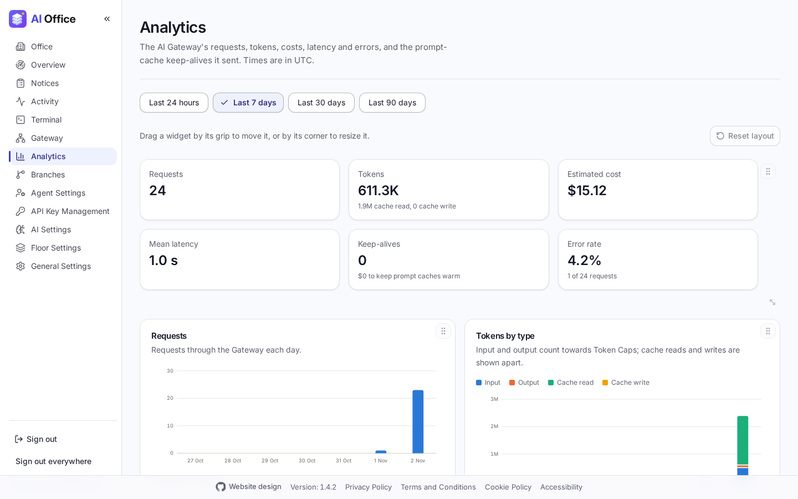](../images/analytics.png) Requests, tokens, cost, latency and errors over time. |
| **AI Settings** [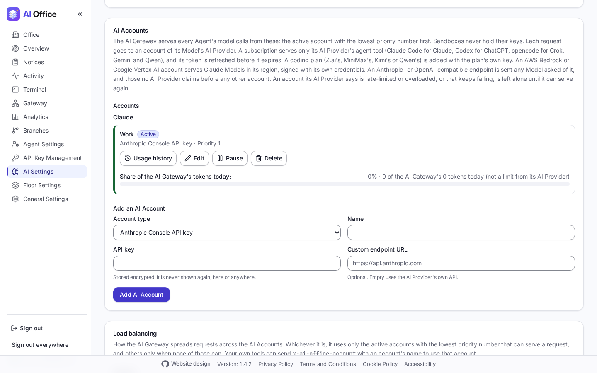](../images/ai-settings.png) AI Providers, AI Accounts (a Claude subscription shows its 5-hour and weekly usage) and the Gateway's configuration. | **General Settings** [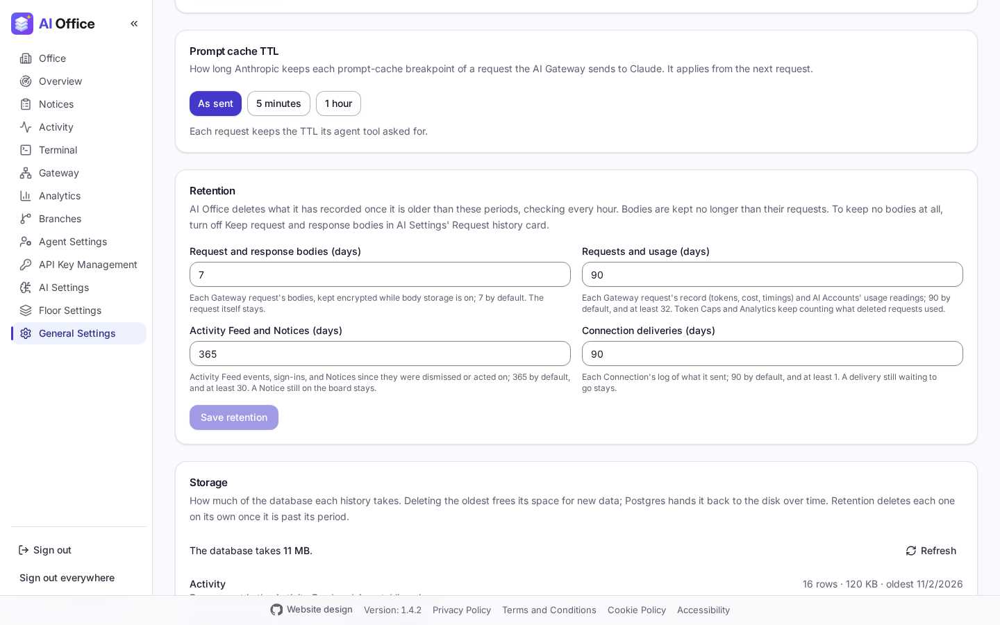](../images/admin-storage.png) Office settings, the prompt-cache TTL and Storage, which frees space by deleting old history. |
| **Agent Settings** [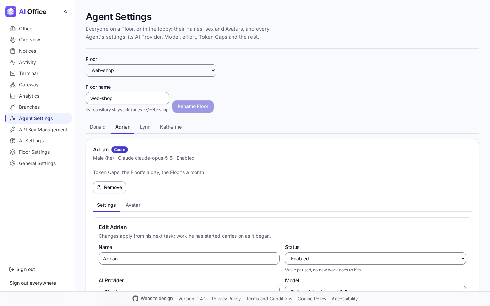](../images/agent-settings.png) A tab for each Agent on a Floor, with its settings (AI Provider, Model, Token Caps and the rest) and its Avatar. | **Floor Settings** [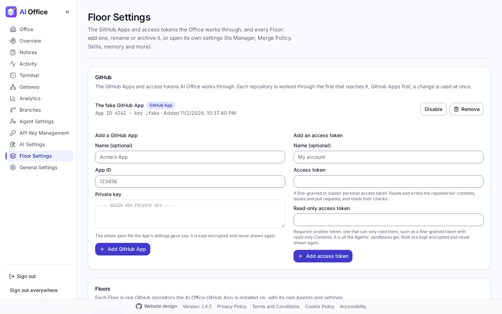](../images/floor-settings.png) The GitHub Apps and access tokens AI Office works through, and every Floor. |
